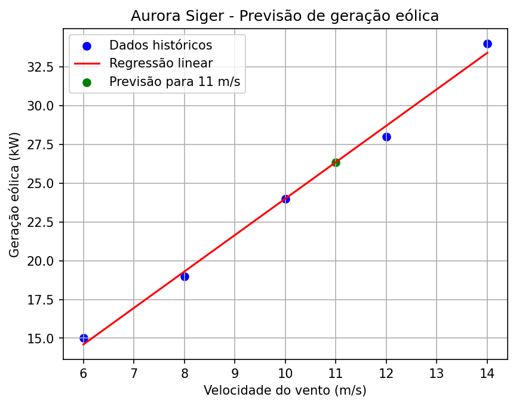

# Aurora Siger - Fase 3: Gerenciamento Energético

Simulação acadêmica do gerenciamento energético de uma colônia em Marte. O protótipo utiliza **dicionários, listas, lógica booleana, funções Python e regressão linear simples** para avaliar a disponibilidade de energia e apoiar decisões operacionais.

## 1. Objetivo

Monitorar a geração e o consumo energético da colônia Aurora Siger, avaliar a reserva das baterias, identificar situações de risco e prever a geração eólica.

O programa utiliza dados fictícios e **não controla equipamentos reais**.

## 2. Requisitos

- Python 3 instalado.
- Bibliotecas Scikit-learn e Matplotlib, relacionadas no `requirements.txt`.

Para instalar as dependências, execute na raiz do repositório:

```bash
python -m pip install -r requirements.txt
```

## 3. Estrutura do repositório

```text
aurora-siger-fase-3/
├── README.md
├── requirements.txt
├── .gitignore
├── codigo/
│   ├── main.py
│   ├── dados.py
│   ├── energia.py
│   ├── previsao.py
│   └── decisoes.py
├── testes/
│   ├── teste_energia.py
│   ├── teste_decisoes.py
│   └── teste_previsao.py
├── docs/
│   └── (relatório PDF a incluir)
└── imagens/
    └── regressao_eolica.png
```

O código está organizado em cinco arquivos, separando dados, cálculos energéticos, previsão, decisões e execução principal.

Os testes complementares são independentes e não são necessários para executar a simulação.

## 4. Como executar a simulação principal

Clone o repositório pelo endereço apresentado em **Code → HTTPS** no GitHub ou utilize **Code → Download ZIP**.

Abra um terminal na raiz do repositório e execute:

```bash
python codigo/main.py
```

Caso seu ambiente utilize `python3`:

```bash
python3 codigo/main.py
```

A execução é automática e apresenta o balanço energético, a reserva das baterias, a previsão eólica e as decisões operacionais.

## 5. Exemplo de entrada e saída

A simulação é executada automaticamente. **Não há entrada digitada pelo usuário**: os parâmetros são definidos no arquivo `codigo/dados.py`.

**Dados de entrada do cenário inicial:**

| Parâmetro | Valor |
|---|---:|
| Geração solar | 40 kW |
| Geração eólica | 25 kW |
| Consumo total dos módulos | 45 kW |
| Capacidade da bateria | 200 kWh |
| Reserva inicial | 120 kWh |
| Intervalo simulado | 1 hora |
| Velocidade prevista do vento | 11 m/s |

**Saída obtida ao executar `python codigo/main.py` na raiz do repositório:**

```text
=== MISSÃO AURORA SIGER - FASE 3 ===

--- BALANÇO ENERGÉTICO ---
Geração total: 65.00 kW
Consumo total: 45.00 kW
Balanço: 20.00 kW

--- RESERVA ENERGÉTICA ---
Reserva inicial: 120.00 kWh
Reserva projetada sem economia: 140.00 kWh

--- PREVISÃO EÓLICA ---
Vento previsto: 11 m/s
Geração eólica prevista: 26.35 kW
Geração total prevista: 66.35 kW
Previsão: geração suficiente para o consumo.

--- DECISÃO OPERACIONAL ---
Situação: EXCEDENTE
Excedente disponível para armazenamento, até a capacidade das baterias.

Gráfico salvo em: imagens/regressao_eolica.png
```

Esse exemplo corresponde ao cenário inicial cadastrado no projeto. Os resultados mudam se os dados da simulação forem alterados.

## 6. Gerenciamento energético

O sistema considera cinco módulos consumidores: Habitação, Energia, Suporte Médico, Logística e Pesquisa Científica.

As principais operações são:

- Calcular a geração solar e eólica e o consumo dos módulos.
- Projetar a reserva energética para uma hora.
- Identificar déficit, reserva baixa e situações críticas.
- Recomendar economia por meio da interrupção temporária de módulos não essenciais.
- Comparar a reserva projetada antes e depois da economia recomendada.

As recomendações são simuladas e não alteram automaticamente o funcionamento dos módulos.

## 7. Previsão de geração eólica

A previsão utiliza **regressão linear simples com Scikit-learn**, relacionando velocidade do vento e geração energética.

O Matplotlib é utilizado para gerar o gráfico com os dados históricos, a reta ajustada e o valor previsto.



Os cálculos, as premissas e as limitações do modelo estarão detalhados no relatório técnico.

## 8. Testes complementares

Os testes verificam os cálculos energéticos, as regras de decisão e a regressão linear, incluindo cenários normais e excepcionais.

Foram desenvolvidos com auxílio de inteligência artificial como recurso complementar de validação.

Para executar individualmente, a partir da raiz do repositório:

```bash
python -m testes.teste_energia
python -m testes.teste_decisoes
python -m testes.teste_previsao
```

Um `AssertionError` indica que alguma verificação não foi satisfeita.

As simulações de exceção não alteram os dados do cenário principal.

## 9. Relatório técnico

O relatório completo será disponibilizado em [**Relatório Aurora Siger - Fase 3 (PDF)**](docs/relatorio_aurora_siger_fase_3.pdf).

O documento reunirá a organização dos dados, as premissas, as regras de decisão, a modelagem matemática, a análise dos resultados e as limitações da simulação.

O projeto foi desenvolvido com apoio de inteligência artificial na discussão de alternativas, implementação e revisão, com decisões e premissas analisadas pelo autor.

---

**Autor:** Renato Santiago de Araujo  
**Curso:** Ciências da Computação - FIAP ON (EAD)  
**Turma:** 1º ano - 1CCOS - 2026/2  
**Ano:** 2026
